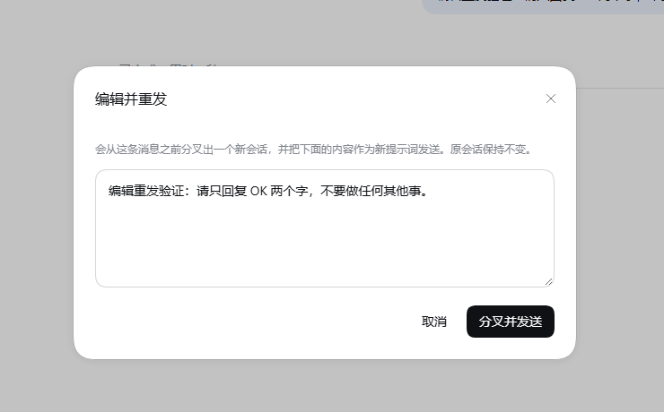
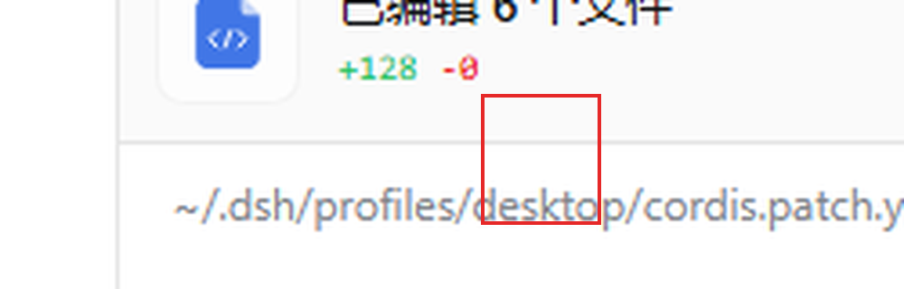
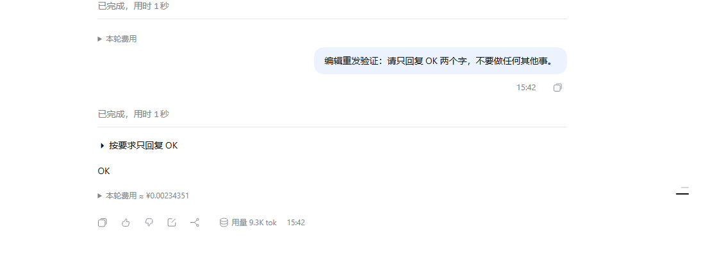

# dsh-edit-resend

**改掉已经发出去的那句话，然后重新问一遍。**

[DeepSeek Harness](https://github.com/deepseek-ai/deepseek-harness)（DSH）Web GUI 的客户端插件：
给消息操作条加一个 ✏️ 按钮，把某条已发送的用户提示词改掉、分叉重发。



---

## 为什么需要它

DSH 没有「编辑已发送的用户消息并重新生成」这个功能，这是**架构决定的**，不是漏做：
会话是一份 append-only 的事件日志（`session.v4.jsonl` + 崩溃检查点），任何已经落盘的
`user/message` 都不能被原地改写。目前消息上能做的操作只有 **复制** 和 **在新对话中分支**。

本插件补上语义上最接近的等价物：

1. 读出某个已完成轮次开头那条用户提示词（文本 + 事件 seq）；
2. `sessions.fork({ atSeq: seq - 1 })` —— 分叉出一个子会话，其继承前缀正好停在这条提示词之前；
3. 打开子会话，把编辑后的文本作为新提示词发给它。

**原会话完全不动**：不改历史、不改标题、不留痕迹。

## 用法

在任意已完成轮次的底部操作条里点铅笔图标，位置是 `复制 → 👍 → 👎 → ✏️ → 分支`：



- 弹出的对话框预填该轮次的原始提示词，直接改；
- 点「分叉并发送」，界面自动跳到新会话，新提示词已经在跑。

下图的子会话就是分叉出来的：上面那个空的「已完成」是切点留下的合成收尾（见
[已知取舍](#已知取舍)），然后是改写后的提示词和模型的新回复。



按钮只在轮次开头确实是用户提示词、且该提示词之前还有事件（`seq > 0`）时可用；
通知唤醒、命令触发的轮次上按钮是灰的，悬停会说明原因。

## 安装

DSH 插件按 profile 安装。以桌面版默认 profile 为例：

```powershell
$profile = "$env:USERPROFILE\.dsh\profiles\desktop"
git clone https://github.com/stefanydevitoqz-creatorPPP/dsh-edit-resend.git "$profile\plugins\dsh-edit-resend"
```

在 `$profile\package.json` 的 `dependencies` 里加一行：

```json
"dsh-edit-resend": "file:plugins/dsh-edit-resend"
```

在 profile 目录里安装：

```bash
pnpm install
```

> 桌面版自带 pnpm，可以这样调：
> `& "<DSH>\resources\runtime\pnpm\bin\pnpm.mjs" install`
> （用 `resources\runtime\primary-runtime\...\node.exe` 跑，或任何 ≥ 8 的 pnpm）

最后让它挂载：**重启 DSH**，或者在侧栏的**插件**页面里把 `dsh-edit-resend` 打开
（市场对纯客户端插件是热挂载的，不用重启；浏览器刷新一次即可看到按钮）。

> ⚠️ **不要**在 `cordis.patch.yml` 里用裸包名手动加这一行。loader 解析插件入口时是从宿主
> 闭包出发往上找 `node_modules`，走不到 profile 目录，裸包名会解析失败。市场写入的是绝对
> `file://` URL —— 那才是对的做法。

## 卸载

1. 从 `$profile\package.json` 的 `dependencies` 删掉 `"dsh-edit-resend"` 那一行；
2. 在 `$profile` 里跑一次 `pnpm install`；
3. 删掉 `$profile\plugins\dsh-edit-resend` 与 `$profile\node_modules\dsh-edit-resend`。

## 工作原理

| 环节 | 做法 |
| --- | --- |
| 挂载点 | ui-chat 声明的 `conversation.chat.assistant-actions`（`list` / session 作用域）。每条已定稿的助手消息都会渲染该条目，owner prop 是 `{ messageId }`，组件另外拿到 `useChat` / `sessionId` / `t` 等框架 share |
| 定位提示词 | 用 `messageId` 在 `useChat` 快照的 `timeline.turns` 里反查轮次号，再 `locations.getTurn(turn)` + `nodes.get(key)` 找该轮第一个 `kind === 'user'` 节点，取 `data.seq` 与 `data.content` |
| 分叉 | `ctx.get('sessions').fork({ sessionId, atSeq: seq - 1, increaseTitle: true })`。`atSeq` 是**闭区间**切点，所以 `seq - 1` 恰好排除掉这条提示词 |
| 发送 | `sessions.using(childId, { source }, ref => …)` 拿到子会话 binding，经 `binding.ctx.get('conversation').sendSession(binding.session, text, [], 'queue')` 提交 —— 和输入框走完全相同的宿主准入路径（含本地提交回显） |
| 依赖 | 只 `require('react')` 和 `@deepseek-ai/dsh-client-ui-primitives`（两者都在平台 module seed 里），样式用 DSW CSS 变量自绘，**零非基线外部依赖** |

文件很小：`lib/index.js` 是宿主半边的空 `apply()`（只为让包出现在 loader 里），
`lib/client.js` 是全部逻辑。

## 已知取舍

- **不是原地编辑**：产物是**新会话**。这是 append-only 日志下能做到的上限。
- **子会话会多一个空的「已完成」尾巴**：切点落在该轮 `turn/start` 与 `user/message` 之间，
  属于宿主**明确支持**的「在未结束轮次内截取」，它会补上合成的结束事件。这是切点的忠实
  表现，不影响上下文正确性。
- **刻意不切更早**：切到 `turn/start` 之前，会把携带原提示词的 `agent/inbox/spliced` 插入
  事件一起继承过来，而它的移除事件不会跟着继承 —— 子会话的输入队列里就会残留一条待处理
  消息。切在 `seq - 1` 保证队列是干净的。
- **附件不搬运**：原消息若含图片/文件，对话框会提示；v1 只搬文本。

## 开发

宿主加载的是 `node_modules/` 里的**副本**，不是 `plugins/` 里的源码。改完源码后：

```powershell
Copy-Item "$profile\plugins\dsh-edit-resend\lib\client.js" `
          "$profile\node_modules\dsh-edit-resend\lib\client.js" -Force
```

再让市场重新挂载（插件页关掉再打开），浏览器刷新一次。

## 许可

MIT © 2026 stefanydevitoqz-creatorPPP

---

## English summary

A client-side plugin for the [DeepSeek Harness](https://github.com/deepseek-ai/deepseek-harness)
(DSH) Web GUI that gives you the closest honest equivalent of *"edit a sent message and regenerate"*.

DSH cannot rewrite history: a session is an append-only event log, so a durable `user/message` is
immutable. This plugin instead reads the opening user prompt of a completed turn, forks a child
session whose inherited prefix stops immediately before that prompt
(`sessions.fork({ atSeq: seq - 1 })`), opens it, and submits your edited text as its new prompt
through the very same host admission path the composer uses. The original session is never touched.

A pencil button appears in the turn action strip (`copy → 👍 → 👎 → ✏️ → branch`) and the dialog is
prefilled with the original prompt.

Most notable limitation: the result is a **new session**, never an in-place edit, and the child
inherits a small synthetic "completed" turn tail from the cut point (the plugin deliberately cuts at
`seq - 1` rather than before `turn/start`, so the child's input queue stays clean).

MIT licensed.
